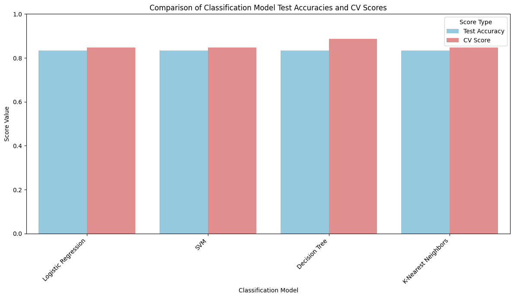
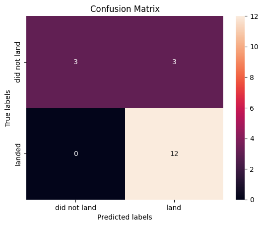
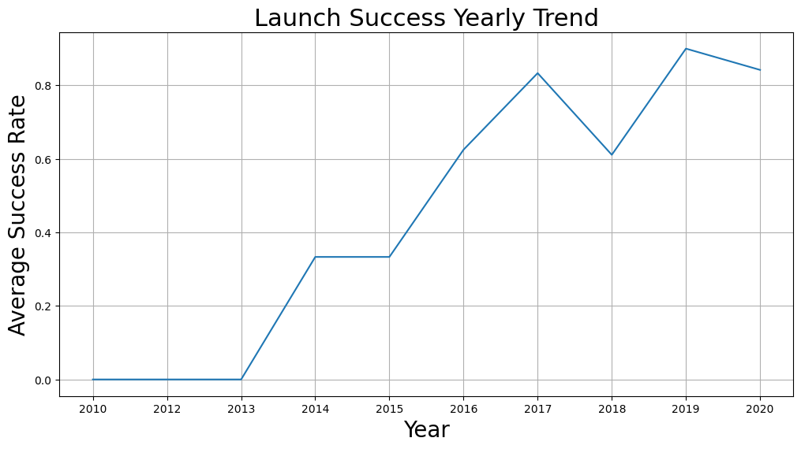
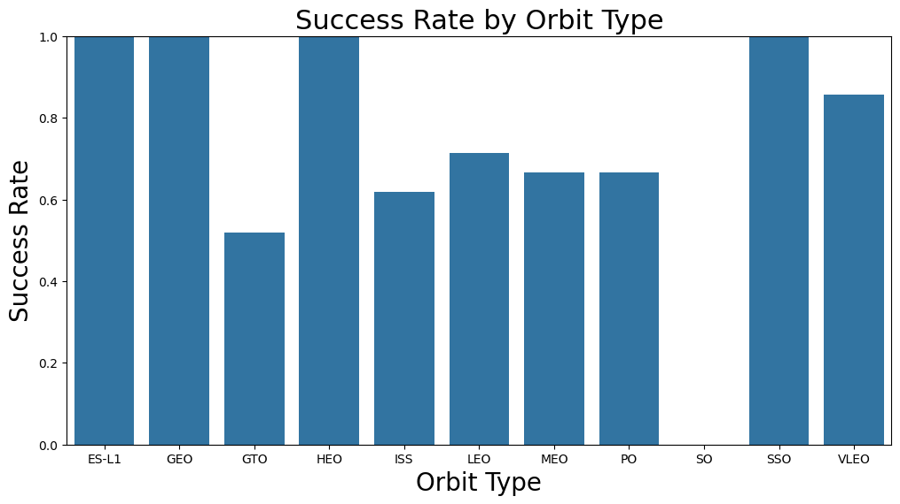
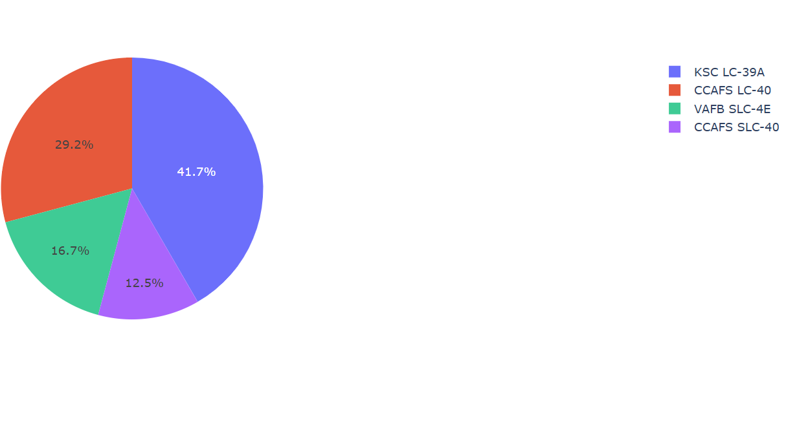
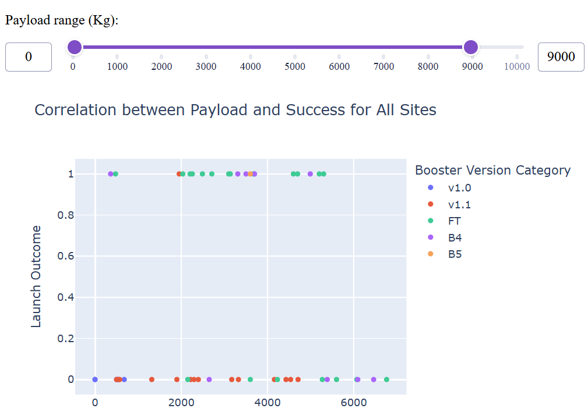
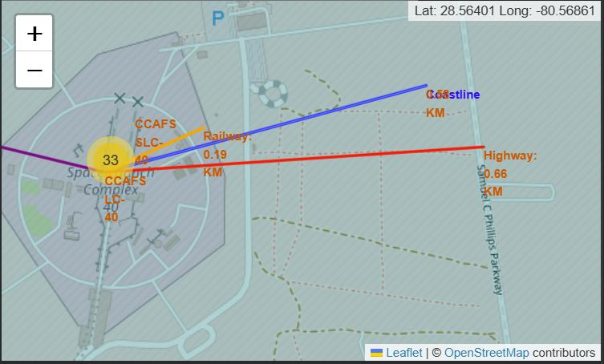

# Winning Space Race with Data Science

Predicting whether a SpaceX Falcon 9 first stage will land successfully, using launch data collected from the SpaceX REST API and Wikipedia.

SpaceX lists a Falcon 9 launch at about $62M, against $165M+ for other providers; most of that saving comes from reusing the first stage. If we can predict whether the first stage will land, we can estimate the cost of a launch, which is useful for a company bidding against SpaceX.

> This is my capstone project for the **IBM Data Science Professional Certificate** (Coursera). The notebook structure and datasets come from the course; the data collection, analysis, dashboard and modelling code is my own work.

## Results at a glance

- **Dataset:** 90 Falcon 9 launches (2010–2020), 3 launch sites, 11 orbit types. Overall landing success rate: **66.7%**.
- **Best model:** all four classifiers reach **83.3% test accuracy**. The decision tree has the highest 10-fold cross-validation accuracy (**88.8%**).
- **Main limitation:** the test set has only 18 launches, so one prediction moves accuracy by ~5.6 points. The test set cannot separate the models; see the "Results and limitations" section of [notebook 08](notebooks/08_machine_learning_prediction.ipynb).

| Model | CV accuracy (10-fold, train) | Test accuracy (n=18) |
|---|---|---|
| Logistic Regression | 0.846 | 0.833 |
| Support Vector Machine | 0.848 | 0.833 |
| Decision Tree | **0.888** | 0.833 |
| K-Nearest Neighbors | 0.848 | 0.833 |

All four models make the same predictions on the test set: every successful landing is caught (12/12), and the only errors are 3 false positives, failed landings predicted as successes.

<p>
  
  
</p>

## Key findings

- **Experience matters:** no first stage landed from 2010 to 2013; the success rate then rose to ~83% in 2017, dipped to ~61% in 2018 and reached ~90% in 2019. Early CCAFS flights account for most failures.
- **Orbit matters:** among orbits with enough launches, VLEO (~86%) and LEO (~71%) do best and GTO is the weakest (~52%). Heavy payloads land more often on Polar, LEO and ISS missions.

<p>
  
  
</p>

- **Launch site:** CCAFS SLC-40 hosts most launches (55 of 90); KSC LC-39A has the highest success rate. VAFB SLC-4E never launched payloads above 10,000 kg.
- **Site location:** launch sites sit close to the coastline (~0.6 km from CCAFS LC-40), railways and highways for logistics, and well away from cities (~23 km to Titusville) for safety.
- **First successful ground-pad landing:** 22 December 2015.

## Interactive dashboard and map

The Plotly Dash app shows the share of successful launches by site and lets you filter payload mass vs. landing outcome by site and booster version. The Folium map measures each launch site's distance to nearby infrastructure.

<p>
  
  
</p>
<p>
  
</p>

## Presentations

- **[Portfolio summary (11 slides, PDF)](report/falcon9-landing-prediction-portfolio.pdf):** the short version for a quick read ([.pptx](report/falcon9-landing-prediction-portfolio.pptx))
- **[Full capstone report (48 slides, PDF)](report/winning-space-race-with-data-science.pdf):** every query, chart and map in detail ([.pptx](report/winning-space-race-with-data-science.pptx))

## Project structure

| Step | Notebook | What it does |
|---|---|---|
| 1 | [01_data_collection_api](notebooks/01_data_collection_api.ipynb) | Pulls launch, rocket, payload and core data from the SpaceX API and resolves IDs into features |
| 2 | [02_data_collection_webscraping](notebooks/02_data_collection_webscraping.ipynb) | Scrapes the Falcon 9 launch tables from Wikipedia with BeautifulSoup |
| 3 | [03_data_wrangling](notebooks/03_data_wrangling.ipynb) | Handles missing values and creates the binary `Class` landing label |
| 4 | [04_eda_sql](notebooks/04_eda_sql.ipynb) | Exploratory analysis with SQL (SQLite) |
| 5 | [05_eda_visualization](notebooks/05_eda_visualization.ipynb) | Visual EDA (Seaborn/Matplotlib) and one-hot feature engineering |
| 6 | [06_launch_site_analysis_folium](notebooks/06_launch_site_analysis_folium.ipynb) | Interactive Folium maps of launch sites, outcomes and proximity distances |
| 7 | [07_dashboard_plotly_dash](notebooks/07_dashboard_plotly_dash.ipynb) | Plotly Dash dashboard: success by site and payload vs. outcome |
| 8 | [08_machine_learning_prediction](notebooks/08_machine_learning_prediction.ipynb) | Logistic regression, SVM, decision tree and KNN with GridSearchCV |

```
├── notebooks/        # analysis pipeline, run in order 01 → 08
├── dashboard/        # standalone Dash app + its dataset
├── images/           # charts and screenshots used in this README
├── report/           # presentations (PDF + PowerPoint)
└── requirements.txt
```


## Run it locally

```bash
pip install -r requirements.txt

# notebooks
jupyter lab notebooks/

# dashboard → http://127.0.0.1:8050
python dashboard/spacex_dash_app.py
```

## Tech stack

Python · pandas · NumPy · scikit-learn · Matplotlib · Seaborn · Folium · Plotly Dash · BeautifulSoup · Requests · SQLite

## Author

**Sumant Chakravarty** · [LinkedIn](https://www.linkedin.com/in/sumant-chakravarty-b117b539/)
